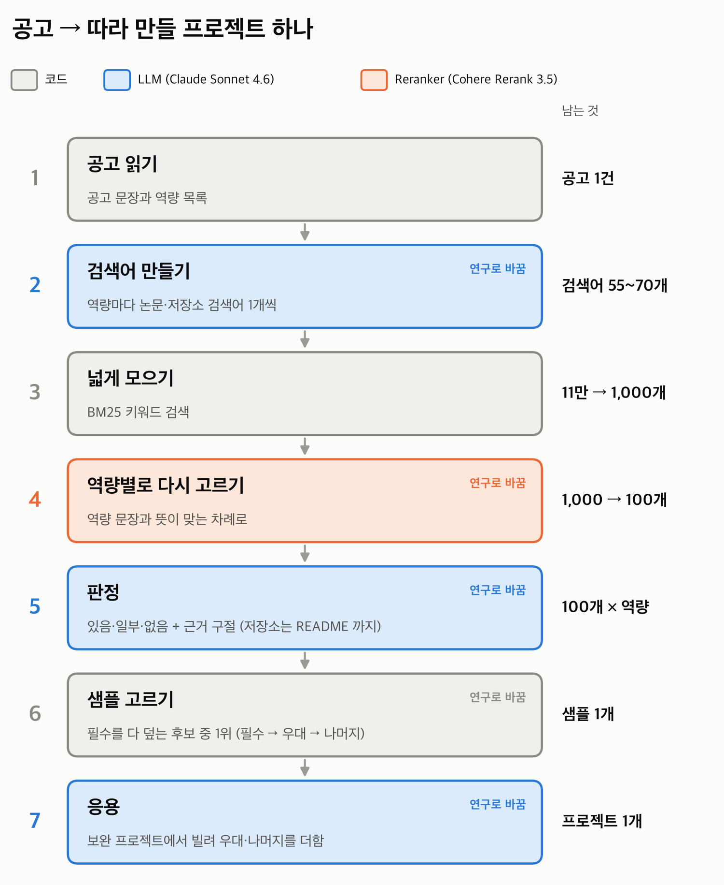
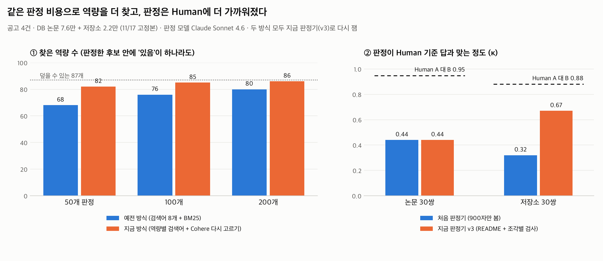

# m2 프로젝트 고르기

공고의 역량을 가장 많이 다루는 공개 프로젝트(논문 또는 GitHub 저장소) 하나를 고른다. 1위가 다루지 못하는 역량은 다른 프로젝트의 방식을 빌려 채운 응용 프로젝트 하나로 만든다.

```bash
.venv/bin/python -m m2_project aws_fde --local      # → outputs/project/<공고>.local.json (예시 두 건 결과는 이미 있다)
```

- 필요한 것: 논문·저장소 DB(아래 "DB 만들기"), `.env` 의 모델 키, Cohere Rerank 를 부를 AWS 프로필(Bedrock us-west-2).
- 비용: 공고 한 건의 판정이 2,000~3,500원, 처음 보는 공고는 검색어와 Rerank 에 600~800원이 더 든다. 한 번 받은 답은 `outputs/` 에 저장해 다시 사지 않는다.



| 단계 | 하는 곳 | 하는 일 |
|---|---|---|
| 1 공고 읽기 | `inputs.py` | m1 결과(공고 문장, 역량, 필수·우대)를 읽는다 |
| 2 검색어 | `local.comp_queries` (모델) | 역량마다 논문용·저장소용 영어 검색어를 하나씩 만든다 |
| 3 넓게 모으기 | `local.rank` (BM25) | 검색어마다 위 100개에 1/(순위+1) 점을 더해 위 1,000개를 남긴다 |
| 4 다시 고르기 | `local.comp_lists` (Cohere Rerank 3.5) | 역량마다 "역량 이름 — 공고 근거 문장"으로 1,000개를 뜻으로 다시 세우고, 위 100개를 판정에 넘긴다 |
| 5 판정 | `pick.judge` (모델) | 후보를 5개씩 읽고 역량마다 있음·일부·없음과 근거 구절을 낸다. 구절이 보여 준 글에 없으면 한 단계 내린다 |
| 6 1위 고르기 | `pick.pick_best` | 있음 1점, 일부 0.5점. 필수 점수가 높은 후보가 이기고, 같으면 우대, 그다음 나머지로 가른다 |
| 7 응용 | `adapt.py` | 1위가 못 다루는 역량을 가장 많이 채우는 후보를 2~3개 고르고(코드), 작업 묶음으로 쓰고(모델), 출처 구절과 시간 예산(4명 × 12주 × 주 7시간)을 확인한다(코드) |

## 잰 결과



- 공고 4건에서, 역량마다 검색어를 만들고 Rerank 로 다시 고르면 50개만 판정해도 덮을 수 있는 역량 87개 중 82개를 찾았다. 예전 방식(공고 전체로 검색어)은 200개를 판정해 80개였다.
- 판정이 기준 답과 맞는 정도(κ, 우연히 맞을 몫을 뺀 값)는 저장소 0.32 → 0.67, 논문 0.44 였다.
- 기준 답은 판정자 둘(Opus 에이전트)이 서로 모르게 논문 본문·README·코드까지 읽고 단 60쌍이고, 사람이 직접 보고 확인했다.

## DB 만들기

```bash
.venv/bin/python -m m2_project.library papers       # 논문 목록 (2020~2026 탑티어 AI·시스템 학회, 오래 걸린다, 이어하기 됨)
.venv/bin/python -m m2_project.library code         # 논문마다 코드 저장소 링크 채우기
.venv/bin/python -m m2_project.repos collect        # GitHub 저장소 목록 (별 200개 이상, GITHUB_TOKEN 있으면 빠르다)
```

출처와 이용 조건은 `data/papers/README.md`, `data/github_repos/README.md`.

## 파일

| 파일 | 하는 일 |
| --- | --- |
| `inputs.py` | 예시 공고 목록(`CASES`)과 m1 결과 읽기 |
| `local.py` | 검색어, BM25, Rerank, 판정 비용 안전장치 |
| `readme.py` | 저장소 README 받기와 정리 |
| `pick.py` | 판정, 근거 검사, 순위 |
| `adapt.py` | 응용: 보완 고르기, 쓰기, 확인 |
| `search.py` | 대표 논문·저장소 이름 검색어 |
| `library.py`, `repos.py` | 논문·저장소 DB 모으기와 읽기 |
| `prompt/` | 모델 지시문 (영어) |
| `assets/` | 이 문서의 그림과 그림을 만드는 스크립트 |
