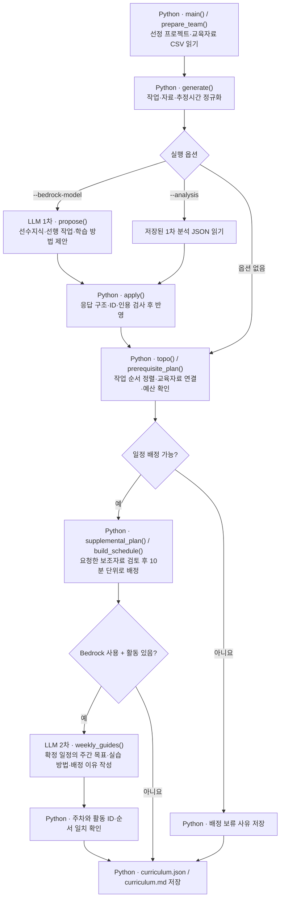

# 라운드랩 커리큘럼 생성기

프로젝트 작업과 교육자료를 연결해 **주당 가용시간에 맞는 12주 계획**을 만든다. 각 주에 무엇을 배우고 구현하는지, 어떤 산출물로 완료를 확인하는지, 출처는 무엇인지 기록한다.

## 빠른 실행

Python 3.10 이상에서 저장소 루트의 다음 명령을 실행한다.

```sh
python3 curriculum_generator.py --size 중형 --output-dir result
```

기본 입력은 `data/aws_fde/`에 있는 [선정 프로젝트 CSV](data/aws_fde/프로젝트_뽑힌프로젝트.csv)와 [선정 교육자료 CSV](data/aws_fde/교육자료_고른자료.csv)다. 다른 폴더에 있는 원본을 읽으려면 `--team-folder "폴더 경로"`를 추가한다.

| 출력 파일 | 담긴 내용 |
|---|---|
| `result/curriculum.md` | 주차별 학습·구현, 시간, 산출물, 완료 기준과 출처 |
| `result/curriculum.json` | 활동 ID, 선수 관계, 미충족 역량과 검증 결과 |

### 주당 시간 선택

| 규모 | 주당 가용시간 | 12주 가용시간 |
|---|---:|---:|
| 소형 | 7시간 | 84시간 |
| 중형 | 14시간 | 168시간 |
| 대형 | 30시간 | 360시간 |

한 번 실행할 때 `--size 소형`, `--size 중형`, `--size 대형` 중 하나를 지정한다. 주당 시간을 직접 입력하려면 `--hours-per-week`를 사용한다. 핵심 작업과 학습이 예산을 넘으면 부족한 시간과 주당 필요한 최소 시간을 결과에 적는다.

### 주 7시간 결과 예시

| 실행 | 교육자료 | 총 배정시간 | 결과 |
|---|---:|---:|---|
| 기본 | 4개 | 77시간 30분 | [Markdown](team_results/curriculum.md) · [JSON](team_results/curriculum.json) |
| 보조자료 2개 추가 | 6개 | 80시간 30분 | [Markdown](team_results/with_supplemental_references/curriculum.md) · [JSON](team_results/with_supplemental_references/curriculum.json) |

팀 CSV는 선정 근거와 관련 작업 번호를 제공한다. 생성기는 이를 바탕으로 `P01` 같은 실습 작업과 소요시간을 제안하고, `W1` 같은 번호는 원본 참조로 기록한다. 확인한 학습 구간에는 절 이름을 붙이고, 미확인 구간에는 CSV 인용문을 바탕으로 찾아볼 범위를 제안한다. 팀 CSV로 만든 결과는 `needs_review` 상태로 저장된다.

## 보조자료 추가

빠진 자료는 CSV의 `id` 열에서 찾아 `--include-reference`로 지정할 수 있다. 아래 명령은 프롬프트 평가 노트북과 Go 자료를 요청한다.

```sh
python3 curriculum_generator.py --hours-per-week 7 \
  --include-reference E564ad08f67 \
  --include-reference E2a4fa23ce7 \
  --output-dir result
```

- 기본 작업과 선수학습을 먼저 배정하고, 남은 시간에 보조자료를 요청 순서대로 검토한다.
- 관련 작업이 있으면 그 작업을 마친 뒤, 관계가 없으면 프로젝트 작업이 모두 끝난 뒤 배치한다.
- 이미 배정된 자료는 한 번만 배정한다. 시간이나 선수지식이 부족하면 `요청한 보조자료`에 사유를 기록한다. 보조자료끼리 선수 관계가 있으면 선수 자료부터 요청한다.

## Python과 LLM 실행 순서

**Python이 학습·구현 시간을 계산하고 주차를 배정한다.** Bedrock을 사용하면 배정 전에 선수학습을 분석하고, 배정 뒤에 주차별 학습 안내를 작성한다.



| 실행 옵션 | AWS 호출 | 동작 |
|---|---:|---|
| 옵션 없음 | 0회 | Python 규칙으로 배정하고 안내를 작성한다. |
| `--analysis 제안.json` | 0회 | 결과 JSON의 `analysis_proposal`을 별도 파일로 저장해 재사용한다. 주차별 안내는 Python이 작성한다. |
| `--bedrock-model 모델ID` | 1~2회 | 선수학습을 제안하고, 일정에 활동이 배정되면 주차별 안내를 작성한다. |

Bedrock을 쓰려면 AWS CLI v2, Converse 도구 호출을 지원하는 모델과 사용 권한이 필요하다. 실행 명령에 `--bedrock-model 모델ID --profile 프로필명 --region 리전명`을 붙이면 작업과 자료의 입력 텍스트가 AWS로 전송된다.

서울 리전에서 `global.anthropic.claude-sonnet-4-6` 모델 ID로 실제 1차 분석과 2차 주차별 안내 생성을 검증했다. 팀 CSV 초안에서 LLM이 제안한 선수지식에 연결 자료가 없으면 일정을 배정하고, Markdown 끝의 ‘추가 학습 참고’에 역량 이름과 검색어를 적는다. JSON에는 미충족 항목이 기록된다. `--strict`에서는 일정을 보류한다.

- **1차 분석 → 일정에 반영.** 팀 CSV에서는 제안된 선수지식과 학습 방법을 반영하고, 선행 작업을 기존 관계에 추가한다. JSON으로 직접 입력한 값과 CSV의 자료별 제공 역량은 우선 적용한다. 원문을 확인할 수 없는 제안은 표시하고, 인용 일치 여부를 `analysis_provenance`에 기록한다. 개별 소요시간은 입력값 또는 CSV 변환 단계의 추정값을 사용한다. [제안 적용](lesson_analysis.py#L65-L119) · [일정 결정](curriculum_generator.py#L631-L792)
- **2차 분석 → 확정 일정에 안내 추가.** 응답의 주차·활동 ID·순서를 확정 일정과 대조한 뒤 목표·방법·이유를 저장한다. 두 호출은 Python의 `subprocess.run()`에서 `aws bedrock-runtime converse`를 실행하고 구조화된 JSON 응답을 받는다. [AWS 호출](lesson_analysis.py#L35-L62) · [주차별 안내 검증](lesson_analysis.py#L122-L139)

## 배정과 검증 기준

1. 핵심 작업과 선행 작업의 순서를 정하고, 작업에 필요한 학습을 앞에 둔다. 이미 아는 개념과 앞에서 배정한 학습은 한 번만 계산한다.
2. 핵심 교육자료를 우선한다. 핵심 우선 경로가 예산을 넘기면 같은 선수조건을 충족하는 대체 경로를 찾는다.
3. 핵심 학습과 구현에 필요한 시간을 확보한 뒤, 가용시간 안에 들어오는 확장 작업과 요청한 보조자료를 추가한다.
4. 활동과 주차를 10분 단위로 배정한다. 개별 활동 시간은 위로, 가용시간 상한은 아래로 맞춘다. 12주 계획에는 실제 학습 비중과 권장 비중을 함께 표시한다. 권장 비중은 1~3주차 60%, 4~8주차 40%, 9~12주차 25%다.

| 상태 | 의미 | 종료 코드 |
|---|---|---:|
| `ready` | 일정 배정 완료 | `0` |
| `needs_review` | 일정은 생성됐고 확인할 항목이 있음 | `3` |
| `blocked` | 필수 학습 경로 또는 시간 예산 문제 등으로 일정 배정 보류 | `3` |
| 입력·분석 오류 | CSV 형식, 분석 응답 등의 오류 | `2` |

`--weeks`로 계획 기간을 바꿀 수 있다. `--strict`를 쓰면 검토가 필요한 계획을 보류한다. 실제 소요시간과 학습 효과는 실측으로 확인해야 한다.

## 가상 예제와 JSON 입력

```sh
python3 curriculum_generator.py \
  --project examples/project_adapt.example.json \
  --materials examples/materials.example.json \
  --hours-per-week 7 --output-dir result
```

예제의 출처·시간·학습자 정보는 가상 데이터다. [가상 예제 결과](examples/output/curriculum.md)

<details>
<summary>JSON 입력 필드</summary>

| 위치 | 필드와 작성 기준 |
|---|---|
| 프로젝트 | `title`, `goal`, `packages[]`. `learner.known`은 이미 아는 개념 ID, `checks.passed`는 상위 검증 결과, `hours.budget`은 구현시간 한도다. |
| 작업 | `id`, `do`, `out`, `hours`, `core`, `competencies`. `requires`는 선수지식 ID, `depends_on`은 먼저 완료할 작업 ID다. 해당 조건이 없으면 빈 배열을 쓴다. `sources`에 근거, `completion_check`에 완료 확인 방법을 적는다. |
| 교육자료 | `core`와 `references` 배열을 쓰거나, `role`을 포함한 단일 `materials` 배열을 쓴다. 각 자료에 `id`, `title`, `url`, `evidence`, `hours` 또는 `minutes`를 적는다. |
| 학습 구간 | `sections[]`에 `teaches`, `requires`, `study_method`와 구간별 시간을 적는다. `teaches` 생략 시 `competencies`를 쓰고, 자료 전체의 선수조건은 구간에도 적용한다. |

같은 개념에는 같은 ID를 사용한다. 작업의 `requires`와 분석 옵션이 모두 빠지면 목표 역량을 바탕으로 자료를 연결하고 검토 항목으로 표시한다. Bedrock 분석에 제공할 설명은 `description`, `summary`, `prerequisite_text`에 담는다.

</details>

## 테스트

```sh
python3 -m unittest discover -s tests -v
```
